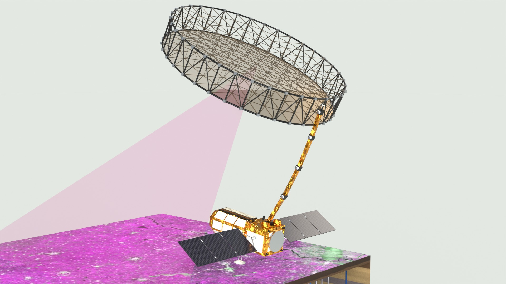

# Saah (ਸਾਹ, "breath")

**Is Punjab's ground still breathing?** One year of real NISAR L-band radar over Punjab's fields, as a scroll-driven 3D story and an explorer.

Live: https://saah-gamma.vercel.app

Built by team Big Hero 7 for the 2026 NASA Space Apps Challenge, "Dancing with the SARs".


```bash
npm install
npm run dev                      # http://localhost:5173, add ?stats for draw calls and fps
npm run build                    # type-check + production build into dist/
python3 scripts/build_data.py    # optional: rebuild the radar atlases from NASA's public quicklooks
python3 scripts/build_motion.py  # optional: ground-motion layer. Also fetch_s2.py + build_paddy.py (rice test), build_sband.py, build_wells.py
blender/build.sh --render        # optional: rebuild saah.blend, the web model and the stills (Blender 5.2+)
                                 # on Windows: .\blender\build.ps1 --render
```



- [HANDOFF.md](HANDOFF.md): why this idea, what is verified, what is not, and what to do next. Start here.
- [PROJECT_EXPLAINED.md](PROJECT_EXPLAINED.md): how the code works and answers to likely questions.
- [SUBMISSION.md](SUBMISSION.md): paste-ready answers for the Space Apps form, with what is and is not done.
- [blender/saah.blend](blender/saah.blend): the 3D scene. NISAR is modelled from its published dimensions; the detail is illustrative.
- [deck/Saah-SpaceApps-2026.pptx](deck/Saah-SpaceApps-2026.pptx): the 7-slide demo deck.

Data: NISAR L-band GCOV and GUNW browse products, NASA/ISRO, via the Alaska Satellite Facility DAAC. Not affiliated with or endorsed by NASA or ISRO. An AI assistant (Claude) helped write the code and text.

Other data: ESA Copernicus Sentinel-2 L2A (open, via Element84 Earth Search on AWS), Sharma, Sidana and Kumari 2024 (well levels, doi:10.63066/23220457.34.1.002), CGWB totals. Full list in SUBMISSION.md.

## Use of AI

The project originated from team-driven ideation, with concepts further refined through AI-assisted exploration. Claude (Anthropic, via Claude Code) and ChatGPT (OpenAI, via Codex) served as execution companions, supporting research, analysis, coding, and design. AI augmented the team's capabilities but never replaced human reasoning, creativity, or decision-making; all core ideas, technical judgments, and final decisions remained team-driven. All figures are backed by cited public sources, with reproducible analysis scripts available in `scripts/`. No NASA logos or official branding are used.
