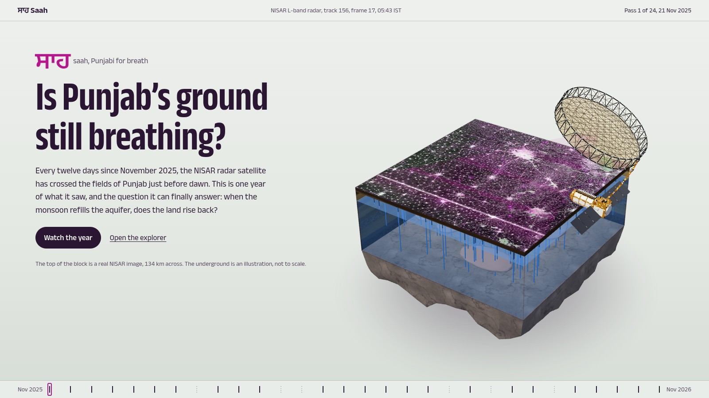

# Saah (ਸਾਹ, "breath")

**Is Punjab's ground still breathing?** One year of real NISAR L-band radar over Punjab's fields, as a scroll-driven 3D story and an explorer.

Live: https://saah-gamma.vercel.app

Built by team Big Hero 7 for the 2026 NASA Space Apps Challenge, "Dancing with the SARs".



```bash
npm install
npm run dev                      # http://localhost:5173, add ?stats for draw calls and fps
npm run build                    # type-check + production build into dist/
python3 scripts/build_data.py    # optional: rebuild the radar atlases from NASA's public quicklooks
blender/build.sh --render        # optional: rebuild saah.blend, the web model and the stills (Blender 5.2+)
                                 # on Windows: .\blender\build.ps1 --render
```


- [HANDOFF.md](HANDOFF.md): why this idea, what is verified, what is not, and what to do next. Start here.
- [PROJECT_EXPLAINED.md](PROJECT_EXPLAINED.md): how the code works and answers to likely questions.
- [blender/saah.blend](blender/saah.blend): the 3D scene. NISAR is modelled from its published dimensions; the detail is illustrative.
- [deck/Saah-SpaceApps-2026.pptx](deck/Saah-SpaceApps-2026.pptx): the 7-slide demo deck.

Data: NISAR L-band GCOV and GUNW browse products, NASA/ISRO, via the Alaska Satellite Facility DAAC. Not affiliated with or endorsed by NASA or ISRO. An AI assistant (Claude) helped write the code and text.
